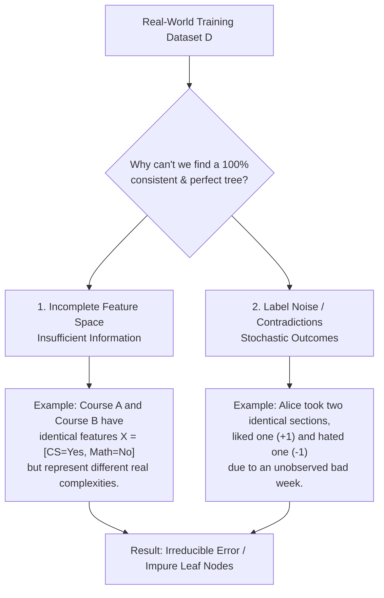
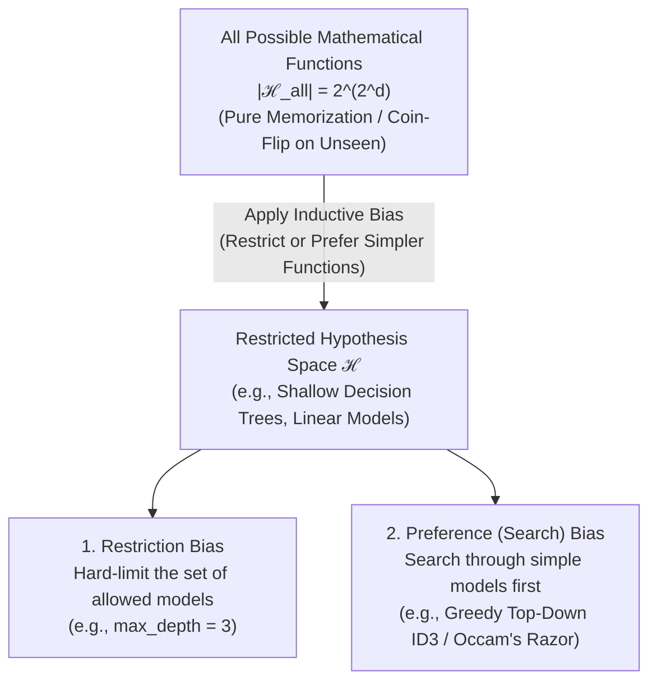
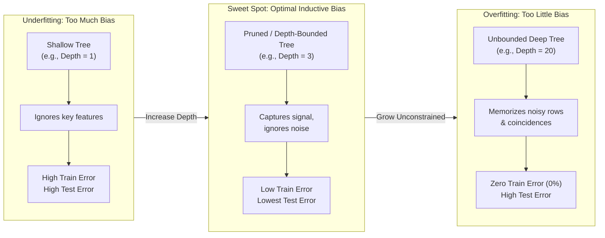
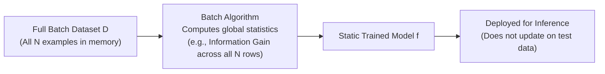
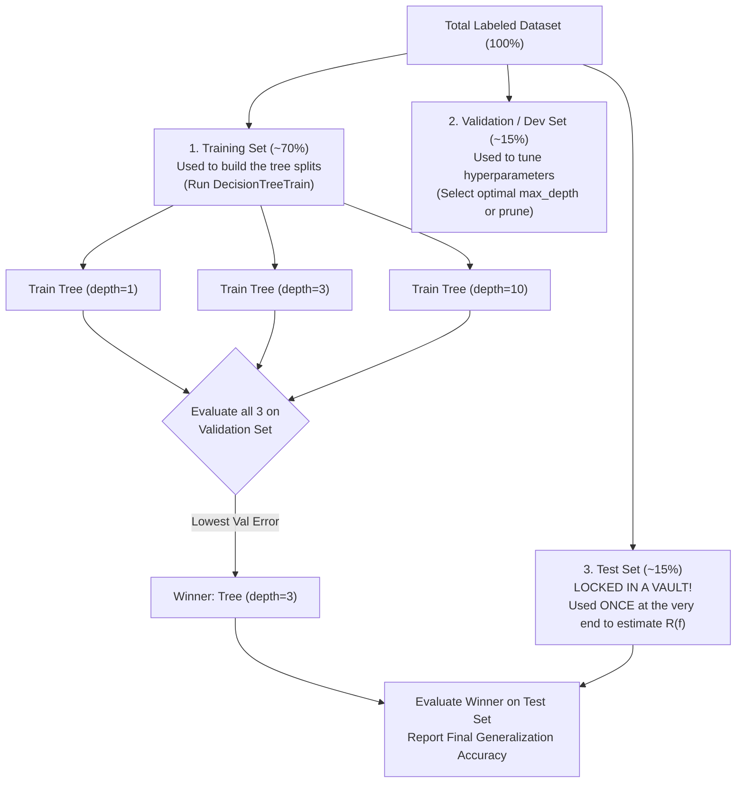

# Chapter 2: The Limits of Learning (Inductive Bias, Overfitting & Generalization)

## 1. Overview: Why Learning Has Fundamental Limits
In Chapter 1, we built a Decision Tree algorithm (`DecisionTreeTrain`) that takes labeled training examples and induces a function $f$ to predict unseen test examples. However, a fundamental question arises: **Can a learning algorithm guaranteedly learn *any* target function from finite data?**

The short answer is **No**. Without making assumptions about the world, generalizing beyond the exact examples seen in the training data is mathematically impossible. This chapter explores the theoretical and practical boundaries of machine learning:
1. **Data Incompleteness & Noise:** Why real-world features and labels are never perfect.
2. **The Futility of Bias-Free Learning (No Free Lunch):** Why an algorithm with zero assumptions can only memorize, never generalize.
3. **Inductive Bias:** The specific assumptions an algorithm uses to leap from seen training data to unseen test data.
4. **Underfitting vs. Overfitting:** How the strength of our inductive bias controls model complexity and generalization error.
5. **Batch vs. Online Learning Paradigms:** How data delivery mechanisms affect learning and convergence.
6. **Train / Validation / Test Protocols:** How to tune hyperparameters (like tree depth) without cheating.

---

## 2. Practical Obstacles: Why Perfect Classification Often Fails

Even before considering unseen test data, a learning algorithm may struggle on the training data itself due to two real-world realities:



### A. Insufficient Features (Feature Incompleteness)
Our feature vector $\mathbf{x} = \langle x_1, x_2, \dots, x_d \rangle$ is only a lossy summary of a real-world object. 
* **Concrete Example:** Suppose we represent courses using only two binary features: `[Is_CS_Dept, Has_Math_Prereq]`. 
* Both *Introduction to Programming* and *Advanced Operating Systems Kernel Design* have the exact same feature vector: `x = [Yes, No]`. 
* However, Alice loves *Intro to Programming* (`y = +1`) and hates *OS Kernel Design* (`y = -1`). Because their feature vectors are identical, **no deterministic function $f(\mathbf{x})$ can ever separate them**.

### B. Noisy Data (Feature Noise & Label Noise)
* **Label Noise:** Human annotators make mistakes, or the target outcome is inherently stochastic (random).
* **Feature Noise:** Sensors or data pipelines corrupt an input attribute (e.g., recording a credit score of `780` as `80`).
* **Impact on Decision Trees:** If a Decision Tree tries to force $0\%$ training error on noisy data, it will grow super-deep branches to isolate every single noisy outlier, destroying its ability to generalize.

---

## 3. Formalizing the Learning Problem: Input Space, Distribution & Loss

To prove when learning works and when it fails, we must define the **Statistical Learning Framework** (Batch Supervised Learning):

```mermaid
flowchart LR
    subgraph Unknown Nature / World
        D_dist[("Data Generating<br>Distribution 𝒟<br>over X × Y")]
    end

    subgraph Training Phase (Batch)
        D_dist -->|"Draw N i.i.d.<br>samples"| TrainSet["Training Set D<br>{(x₁,y₁), ..., (xₙ,yₙ)}"]
        TrainSet --> Alg["Batch Learning Algorithm<br>(e.g., DecisionTreeTrain)"]
        H_space["Hypothesis Space ℋ<br>(Set of allowed functions)"] --> Alg
        Alg -->|"Selects best"| f_hat["Learned Function f ∈ ℋ"]
    end

    subgraph Evaluation Phase (Generalization)
        D_dist -->|"Draw new unseen<br>test pair (x, y)"| TestPoint["Test Example (x, y)"]
        f_hat -->|"Predict ŷ = f(x)"| Loss["Loss Function ℓ(y, ŷ)<br>Expected Risk R(f)"]
        TestPoint --> Loss
    end
```

### Core Mathematical Definitions

1. **Input Space ($\mathcal{X}$):** The set of all possible feature vectors (e.g., $\mathcal{X} = \{0, 1\}^d$ for $d$ binary features, or $\mathbb{R}^d$ for $d$ continuous features).
2. **Output / Label Space ($\mathcal{Y}$):** The set of all possible target labels (e.g., $\mathcal{Y} = \{-1, +1\}$ for binary classification).
3. **Hypothesis Space ($\mathcal{H}$):** The restricted family of functions the learning algorithm is allowed to consider (e.g., all Decision Trees of depth $\le 3$, or all linear hyperplanes).
4. **Data Generating Distribution ($\mathcal{D}$):** An unknown joint probability distribution over $\mathcal{X} \times \mathcal{Y}$.
   * **Crucial Rule:** We do **not** know $\mathcal{D}$. We can only observe finite samples drawn **i.i.d.** (Independent and Identically Distributed) from $\mathcal{D}$.
   * **Golden Assumption of ML:** Both the **Training Data** and the **Test Data** are drawn from the *exact same* probability distribution $\mathcal{D}$. (If you train on medical data from 1950 and test on patients in 2026, distribution shift breaks learning).
5. **Loss Function ($\ell(y, \hat{y})$):** Measures the cost of predicting $\hat{y} = f(\mathbf{x})$ when the true label is $y$.
   * **0-1 Loss (Classification Error):**
     $$\ell_{0\text{-}1}(y, \hat{y}) = \mathbb{I}[y \neq \hat{y}] = \begin{cases} 0 & \text{if } y = \hat{y} \\ 1 & \text{if } y \neq \hat{y} \end{cases}$$
   * **Squared Error Loss (Regression):**
     $$\ell_{\text{sq}}(y, \hat{y}) = (y - \hat{y})^2$$
6. **Training Error (Empirical Risk $\hat{R}_D(f)$):** The average loss over the finite training dataset $D = \{(\mathbf{x}_1, y_1), \dots, (\mathbf{x}_N, y_N)\}$:
   $$\hat{R}_D(f) = \frac{1}{N} \sum_{i=1}^{N} \ell\big(y_i, f(\mathbf{x}_i)\big)$$
7. **True Test Error (Expected Risk $R_{\mathcal{D}}(f)$):** The expected loss over the entire unknown distribution $\mathcal{D}$:
   $$R_{\mathcal{D}}(f) = \mathbb{E}_{(\mathbf{x}, y) \sim \mathcal{D}} \Big[ \ell\big(y, f(\mathbf{x})\big) \Big]$$

> **The Fundamental Goal of Machine Learning:** Minimize the **True Expected Risk $R_{\mathcal{D}}(f)$**, even though the algorithm only has access to the **Empirical Risk $\hat{R}_D(f)$**!

---

## 4. The Combinatorial Explosion & Futility of Bias-Free Learning

Why can't we simply let our Hypothesis Space $\mathcal{H}$ contain *all possible mathematical functions* and pick one that gets $0\%$ error on the training set?

### Combinatorial Calculation: How Many Functions Exist?
Suppose each example is described by $d$ binary features: $\mathbf{x} \in \{0, 1\}^d$, and the output label is binary: $y \in \{-1, +1\}$.

* **Step 1: How many unique input feature vectors $\mathbf{x}$ exist in $\mathcal{X}$?**
  Since each of the $d$ features can be $0$ or $1$, there are:
  $$\vert{}\mathcal{X}\vert{} = 2^d \text{ distinct input rows in the truth table}$$
* **Step 2: How many distinct boolean functions $f: \{0,1\}^d \to \{-1, +1\}$ exist?**
  For each of the $2^d$ input rows, a function can output either $-1$ or $+1$. Therefore, the total number of possible functions is:
  $$\vert{}\mathcal{H}_{\text{all}}\vert{} = 2^{(2^d)}$$

### Concrete Numerical Example ($d = 4$ vs. $d = 20$ Features)

| Number of Binary Features ($d$) | Number of Unique Inputs ($2^d$) | Total Possible Functions ($2^{2^d}$) |
| :--- | :--- | :--- |
| $d = 2$ | $4$ inputs | $2^4 = 16$ functions |
| $d = 4$ | $16$ inputs | $2^{16} = 65,536$ functions |
| $d = 10$ | $1,024$ inputs | $2^{1024} \approx 1.79 \times 10^{308}$ functions |
| $d = 20$ | $1,048,576$ inputs | $2^{1,048,576}$ (More than atoms in the universe!) |

### Worked Example: The Complete Truth Table Dilemma ($d = 3$ Features)
Suppose we have $d = 3$ binary features (`x1`, `x2`, `x3`), so there are $2^3 = 8$ possible distinct inputs. There are $2^8 = 256$ possible functions in $\mathcal{H}_{\text{all}}$.

Suppose we collect $N = 5$ training examples and observe their true labels:

| Input Row | $x_1$ | $x_2$ | $x_3$ | True Training Label ($y$) | Consistent Function $f_1$ | Consistent Function $f_2$ | Consistent Function $f_3$ |
| :--- | :---: | :---: | :---: | :---: | :---: | :---: | :---: |
| **Row 1 (Seen)** | 0 | 0 | 0 | **$-1$** | $-1$ | $-1$ | $-1$ |
| **Row 2 (Seen)** | 0 | 0 | 1 | **$+1$** | $+1$ | $+1$ | $+1$ |
| **Row 3 (Seen)** | 0 | 1 | 0 | **$-1$** | $-1$ | $-1$ | $-1$ |
| **Row 4 (Seen)** | 0 | 1 | 1 | **$+1$** | $+1$ | $+1$ | $+1$ |
| **Row 5 (Seen)** | 1 | 0 | 0 | **$-1$** | $-1$ | $-1$ | $-1$ |
| **Row 6 (UNSEEN)** | 1 | 0 | 1 | **?** | **$+1$** | **$-1$** | **$+1$** |
| **Row 7 (UNSEEN)** | 1 | 1 | 0 | **?** | **$-1$** | **$+1$** | **$+1$** |
| **Row 8 (UNSEEN)** | 1 | 1 | 1 | **?** | **$+1$** | **$-1$** | **$+1$** |

**Look at what happens on the 3 Unseen Test Rows (Rows 6, 7, 8):**
* Out of the $256$ total functions, $2^3 = 8$ functions agree $100\%$ with all $5$ training examples ($0\%$ training error).
* On **Unseen Row 6 (`1, 0, 1`)**, exactly **4** of those consistent functions predict $+1$, and **4** of them predict $-1$!
* **The Takeaway (No Free Lunch Theorem):** Without an external preference (bias) to prefer $f_1$ (which represents the simple rule `y = +1 if x3 == 1 else -1`) over $f_2$ or $f_3$, our algorithm has **zero mathematical basis** to predict unseen examples better than a random $50/50$ coin flip!

---

## 5. Inductive Bias & Occam's Razor

To generalize to unseen examples, every learning algorithm **must** bring prior assumptions about which functions are more likely to be true. This set of assumptions is called **Inductive Bias**.



### Two Types of Inductive Bias
1. **Restriction Bias (Hypothesis Space Restriction):**
   * Completely forbids certain complex functions.
   * *Example:* A Linear Classifier restricts $\mathcal{H}$ strictly to straight hyperplanes. A Depth-2 Decision Tree restricts $\mathcal{H}$ strictly to trees with at most $2$ levels of splits.
2. **Preference Bias (Search Bias):**
   * The algorithm can theoretically represent any function, but its search procedure strongly prefers simpler functions over complex ones.
   * *Example:* **Greedy Decision Tree Induction (`DecisionTreeTrain`)**. A full decision tree can represent *any* boolean function, but because our algorithm splits top-down greedily using Information Gain and stops as soon as nodes are pure, it naturally prefers **shallow trees with fewer nodes** over giant trees.

### What is the Inductive Bias of a Decision Tree?
* **Occam's Razor:** Prefer the **smallest/shallowest tree** that accurately fits the data.
* **High-Information Features Near the Root:** Features with higher single-attribute Information Gain (correlation with the label) should dominate the decision boundary.
* **Axis-Aligned Rectangular Splits:** The input space is partitioned by orthogonal hyperplanes parallel to the feature axes ($x_j \le \theta$).

---

## 6. Underfitting vs. Overfitting in Decision Trees

Because the real world contains noise and finite training samples, growing a Decision Tree all the way to $0\%$ training error is dangerous.



### Concrete Example: How Noise Causes Overfitting in a Tree
Suppose the true underlying rule in nature is simply:
$$\text{True Rule: } y = +1 \iff x_1 = 1$$
However, our training data has **10% label noise** (1 out of 10 examples has its label accidentally flipped).
* **Tree A (Depth = 1):** Splits only on $x_1$.
  * **Training Error:** $10\%$ (misses the 1 noisy training example).
  * **True Test Error:** **$10\%$** (matches the optimal Bayes error rate!).
* **Tree B (Unbounded Depth = 10):** Splits on $x_1$ first, and then adds 9 extra levels of splits on irrelevant features ($x_2, x_3, \dots, x_{10}$) just to isolate and memorize that 1 noisy example.
  * **Training Error:** $0\%$ (perfect score on training set!).
  * **True Test Error:** **$25\%+$** (terrible on new data because legitimate test examples take the noisy branches and get misclassified!).

---

## 7. Learning Algorithms & Batch vs. Online Learning

In machine learning, algorithms are categorized by how they consume training data and construct their hypothesis $f$:

### A. Batch Learning Algorithms (Offline Learning)
In **Batch Learning**, the algorithm is given the **entire training dataset $D = \{(\mathbf{x}_1, y_1), \dots, (\mathbf{x}_N, y_N)\}$ all at once** before producing the learned function $f$.



#### Key Batch Algorithms Covered in Early ML:
1. **`DecisionTreeTrain` (Greedy Batch Tree Induction):**
   * Requires the **entire batch $D$** at the root node to compute exact empirical probabilities $P(y \mid D)$ and Information Gain $IG(D, j)$ across all $N$ examples.
   * Partitions the batch into sub-batches $D_{\text{left}}$ and $D_{\text{right}}$ and recurses.
2. **Exhaustive Hypothesis Search (Conceptual Baseline):**
   * Enumerates every function $h \in \mathcal{H}$, computes batch empirical error $\hat{R}_D(h) = \frac{1}{N}\sum_{i=1}^N \ell(y_i, h(\mathbf{x}_i))$, and returns $\arg\min_{h \in \mathcal{H}} \hat{R}_D(h)$ (Empirical Risk Minimization / ERM).
3. **Decision Stump Algorithm (1-Rule Batch Learner):**
   * A restricted batch algorithm where `max_depth = 1`. It scans all $d$ features across the entire batch $D$ and picks the single feature that minimizes batch training error.

### B. Comparison: Batch Learning vs. Online (Streaming) Learning

| Dimension | Batch Learning (e.g., `DecisionTreeTrain`, Batch ERM) | Online / Incremental Learning (e.g., Perceptron, SGD) |
| :--- | :--- | :--- |
| **Data Access** | Sees all $N$ training examples simultaneously in memory. | Sees $1$ example $(\mathbf{x}_t, y_t)$ at a time in a sequential stream. |
| **Statistical Estimates** | Computes global feature statistics (e.g., exact Entropy/Gini over $N$ rows) before making a decision. | Updates model weights immediately after each single example based on local error. |
| **Memory Footprint** | $O(N \cdot d)$ — must store the full dataset matrix in RAM. | $O(d)$ — only stores current model parameters; discards example after update. |
| **Adapting to New Data** | Must retrain the entire tree/model from scratch on old + new data. | Continuously adapts in real time as new examples arrive. |

---

## 8. Controlling Complexity: Hyperparameters, Pruning & Validation Splits

Because the training error $\hat{R}_D(f)$ always decreases (or stays flat) as tree depth increases, **we can NEVER use Training Error to choose hyperparameters** like `max_depth`. And we **cannot touch the Test Set** during training or tuning, or else we leak test information!

### Solution: The 3-Way Data Split (Train / Validation / Test)

We partition our available labeled dataset into three strictly disjoint subsets:



### Algorithms for Preventing Overfitting in Decision Trees

#### Algorithm 1: Pre-Pruning (Early Stopping via Hyperparameters)
Stop the recursive `DecisionTreeTrain` algorithm early before it overfits:
* **`max_depth`:** Stop splitting once the current node is at depth $K$.
* **`min_samples_split`:** Do not split a node if $\vert{}D_{\text{node}}\vert{} < m$.
* **`min_impurity_decrease` (Cutoff Threshold):** Only split if Information Gain $IG(D, j) > \epsilon$.

#### Algorithm 2: Post-Pruning (Reduced Error Pruning with Validation Set)
1. **Step 1:** Run `DecisionTreeTrain` on the **Training Set** with no restrictions to grow a full, overfitted tree $T_{\text{full}}$.
2. **Step 2:** Loop bottom-up through every internal decision node $v$ in $T_{\text{full}}$:
   * Temporarily replace the entire subtree rooted at $v$ with a single **Leaf Node** predicting the majority class of training examples that reached $v$.
   * Measure the accuracy of this pruned tree on the **Validation Set ($D_{\text{val}}$)**.
   * **If** Validation Error decreases or stays the same ($\hat{R}_{\text{val}}(T_{\text{pruned}}) \le \hat{R}_{\text{val}}(T_{\text{current}})$), permanently keep the pruned leaf!
3. **Step 3:** Repeat until pruning any remaining node hurts Validation Set accuracy.

---

## 9. Complete Python Reference: Diagnosing Underfitting, Overfitting & Tuning `max_depth`

```python
import numpy as np
from sklearn.tree import DecisionTreeClassifier
from sklearn.model_selection import train_test_split
from sklearn.metrics import accuracy_score

# 1. Generate synthetic data where true rule only depends on first 3 features, plus 15% label noise
np.random.seed(42)
N, d = 500, 15
X = np.random.randint(0, 2, size=(N, d))

# True underlying rule: y = 1 if (x0 == 1 and x1 == 1) or (x2 == 1)
y_true = ((X[:, 0] == 1) & (X[:, 1] == 1)) | (X[:, 2] == 1)
y = y_true.astype(int)

# Inject 15% random label noise (simulating real-world noisy data)
noise_mask = np.random.rand(N) < 0.15
y[noise_mask] = 1 - y[noise_mask]

# 2. Split into Train (70%), Validation (15%), and Test (15%)
X_train, X_temp, y_train, y_temp = train_test_split(X, y, test_size=0.30, random_state=42)
X_val, X_test, y_val, y_test = train_test_split(X_temp, y_temp, test_size=0.50, random_state=42)

print(f"{'Max Depth':<12} | {'Train Error':<14} | {'Val Error':<14} | {'Regime'}")
print("-" * 62)

best_depth = None
lowest_val_error = float("inf")

# 3. Model Selection Loop using Validation Set
for depth in [1, 2, 3, 5, 8, 12, None]:
    clf = DecisionTreeClassifier(max_depth=depth, criterion="entropy", random_state=42)
    clf.fit(X_train, y_train)
    
    train_err = 1.0 - accuracy_score(y_train, clf.predict(X_train))
    val_err = 1.0 - accuracy_score(y_val, clf.predict(X_val))
    
    if val_err < lowest_val_error:
        lowest_val_error = val_err
        best_depth = depth
        
    regime = "Underfitting" if (depth is not None and depth < 2) else (
             "Optimal Zone" if (depth in [2, 3]) else "Overfitting (Memorizing Noise)")
    depth_str = str(depth) if depth is not None else "Unbounded"
    print(f"{depth_str:<12} | {train_err:<14.3f} | {val_err:<14.3f} | {regime}")

# 4. Final Evaluation on the Locked Test Set using the Winner Depth
best_clf = DecisionTreeClassifier(max_depth=best_depth, criterion="entropy", random_state=42)
best_clf.fit(X_train, y_train)
test_err = 1.0 - accuracy_score(y_test, best_clf.predict(X_test))

print("-" * 62)
print(f"Selected Best Max Depth (via Val Set): {best_depth}")
print(f"Final Generalization Test Error:       {test_err:.3f}")
```

---

## 10. Quick-Review Summary Cheat Sheet

| Concept | Definition | Key Takeaway |
| :--- | :--- | :--- |
| **Data Generating Distribution ($\mathcal{D}$)** | Unknown joint probability distribution over $\mathcal{X} \times \mathcal{Y}$. | Training and Test sets must be drawn **i.i.d.** from the same $\mathcal{D}$ for learning to succeed. |
| **Empirical Risk ($\hat{R}_D(f)$)** | Error rate on the observed training set $D$. | Minimizing $\hat{R}_D(f)$ alone leads to memorization (overfitting). |
| **Expected Risk ($R_{\mathcal{D}}(f)$)** | True error rate over the entire distribution $\mathcal{D}$. | The true goal of ML; estimated using an untouched Test Set. |
| **Combinatorial Function Space** | $2^{(2^d)}$ boolean functions exist for $d$ binary features. | Too vast to search without bias; many functions fit training data but disagree on test data. |
| **Inductive Bias** | Prior assumptions used to prefer one hypothesis over another. | **Required** for generalization. Without bias, a learner is no better than coin-flipping on unseen inputs. |
| **Underfitting** | Model is too restricted (e.g., `depth = 1`). | High Train Error + High Test Error. |
| **Overfitting** | Model is too complex; fits noise (e.g., `depth = None`). | Near-Zero Train Error + High Test Error. |
| **Validation / Dev Set** | Held-out subset used to tune hyperparameters (`max_depth`). | Keeps the Test Set pure so we don't overfit our hyperparameter choices to the Test Set. |

```
